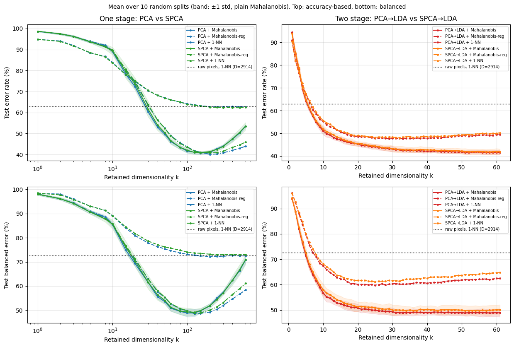
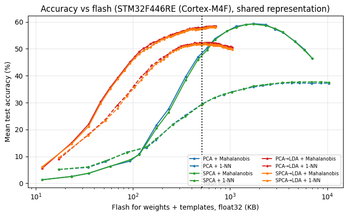
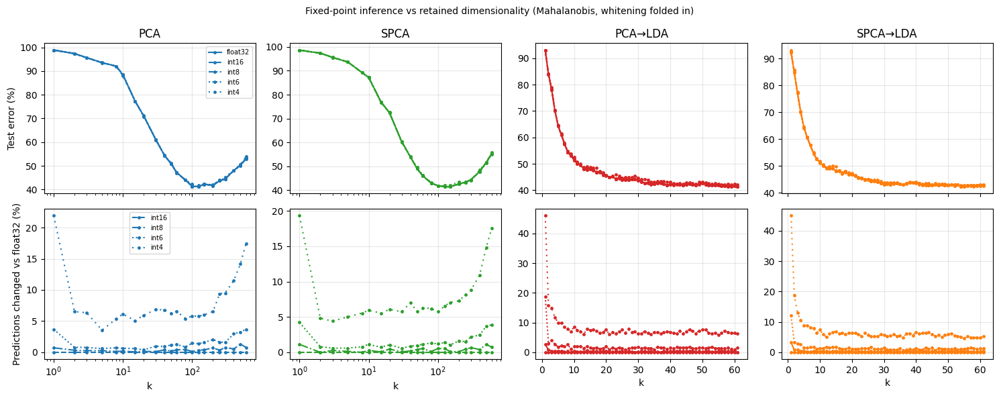
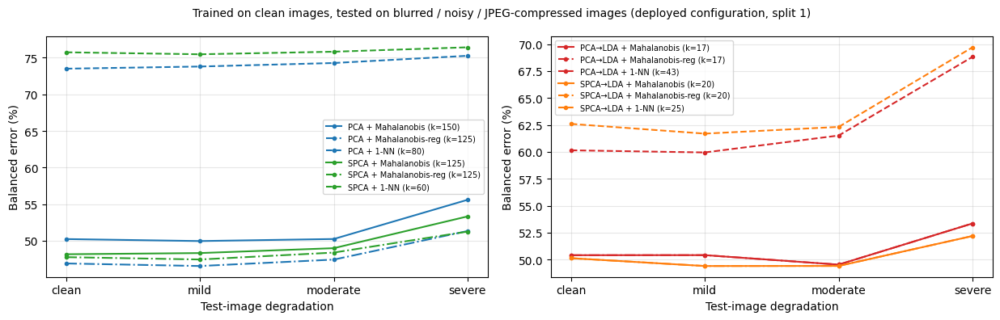
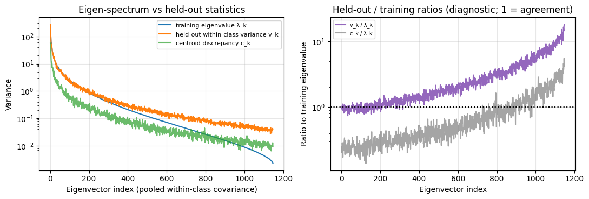

<div align="center">

# 🔍 Compact Face Recognition with Dimensionality Reduction

### PCA · Supervised PCA · Linear Discriminant Analysis · Fixed-Point Inference

**A reproducible investigation of face identification accuracy, model size, robustness, and embedded deployment constraints.**

   

[**Explore the notebook**](MakZhiJun_IE4476.ipynb) · [**Results**](#-results-at-a-glance) · [**Methods**](#-methods) · [**How to run**](#-getting-started)

</div>

---

## ✨ Project overview

Can a face identification model retain useful accuracy while compressing thousands of pixel features into a small representation suitable for a microcontroller?

This project benchmarks **PCA**, **supervised PCA (SPCA)**, **PCA → LDA**, and **SPCA → LDA** on a filtered **Labeled Faces in the Wild (LFW)** dataset. It compares classical distance-based classifiers, evaluates reliability under synthetic image degradation, and simulates low-precision model storage and arithmetic.


## 📌 Results at a glance

| Metric | Notebook result | Context |
|:--|--:|:--|
| **62 identities** | **3,023 face images** | LFW subjects with ≥20 images; 62 × 47 grayscale |
| **2,914 → 28 features** | **~104× fewer features** | SPCA → LDA + Mahalanobis; median deployment dimension over 10 runs |
| **56.1% accuracy** | **49.6% balanced accuracy** | Same SPCA → LDA + Mahalanobis configuration; mean over 10 stratified splits |
| **58.8% accuracy** | **51.4% balanced accuracy** | PCA + regularized Mahalanobis; higher-accuracy comparison, more dimensions |
| **10 repeated splits** | **50% train / 50% test** | Validation for model selection is carved from training only |
| **INT8 and lower precision** | **Simulated** | Quantization tested in Python; no STM32 deployment in this notebook |

> **Interpretation:** The compact 28-feature result is a *median configuration size*, while the 56.1% test accuracy is the *mean across splits* for that method/classifier. They are related summary statistics, not necessarily the results of one identical fitted model. This is closed-set identification on a filtered, imbalanced dataset—not general face recognition performance.

## 📈 Results and visualizations

### 1 · Accuracy versus retained dimensions



The notebook compares reduced representations and three classifiers as the number of retained dimensions changes. Two-stage approaches (PCA → LDA and SPCA → LDA) reach competitive results with far fewer dimensions than single-stage projections.

### 2 · Accuracy versus Flash budget



This figure illustrates the accuracy/storage trade-off, including a **512 KiB Flash reference line for the STM32F446RE**. Storage is calculated for model weights, biases, scales, and templates—not the complete firmware image.

### 3 · Fixed-point quantization sensitivity



A folded projection-plus-Mahalanobis implementation is compared with simulated **FP32, FP16, INT8, INT6, and INT4** storage/arithmetic choices. The notebook checks prediction changes and includes accumulator-overflow diagnostics. This is *simulation*, not measured MCU execution.

<details>
<summary><b>Additional plots: robustness and covariance reliability</b></summary>

#### Synthetic camera degradation



Models are trained on clean images; blur, noise, and JPEG compression are applied to test images before normalization. Results use a single held-out split.

#### Covariance reliability



The notebook compares training and held-out within-class covariance behavior to investigate statistical reliability and potential overfitting of high-dimensional estimates.

</details>

## 🧠 Methods

| Stage | Implementation |
|:--|:--|
| **Dataset** | `fetch_lfw_people` with ≥20 examples per identity, 62 × 47 grayscale |
| **Preprocessing** | Per-image z-score normalization; stratified splits |
| **Dimensionality reduction** | PCA from SVD; SPCA from supervised scatter structure; optional LDA via generalized eigenproblem |
| **Classifiers** | Minimum Mahalanobis, regularized Mahalanobis, Euclidean 1-nearest neighbor |
| **Model selection** | Validation subset of training data; separate classifier and dimensionality choices |
| **Evaluation** | Test accuracy, balanced accuracy, repeated splits, exploratory paired tests |
| **Deployment study** | Folded linear mapping, Flash/RAM/operation estimates, fixed-point simulation |

### Edge-oriented design

The linear transformations can be **folded** into a single projection and bias, followed by a template comparison. This structure makes storage and operations straightforward to reason about:

```text
Input face (2,914 pixels)
       │ per-image normalization
       ▼
Folded projection matrix + bias
       │ k-dimensional feature vector
       ▼
Nearest class template
       │
       ▼
Predicted identity
```

The example hardware target in the notebook is an **STM32F446RE (Cortex-M4F; 180 MHz assumed, 512 KiB Flash, 128 KiB RAM)**. All latency estimates are based on assumed cycles per operation; **inference was not timed or deployed on the physical MCU**.

## 🛠️ Getting started

### Requirements

- Python 3 with Jupyter or Google Colab
- NumPy, pandas, Matplotlib, Pillow, SciPy, scikit-learn

Install local dependencies:

```bash
python -m pip install numpy pandas matplotlib pillow scipy scikit-learn notebook
```

Then run:

```bash
jupyter notebook MakZhiJun_IE4476.ipynb
```

Run cells from top to bottom. scikit-learn's LFW loader may **download the dataset on first use**, so internet access is needed initially.

> **Runtime:** The saved notebook used `N_REPEATS = 10` and reports roughly 1,255 seconds for the repeated-split experiment alone, before remaining analyses. For a lighter exploration, set `N_REPEATS = 2` in the configuration cell.

### Repository structure

```text
.
├── MakZhiJun_IE4476.ipynb   # Full experiment and saved outputs
├── README.md                 # Project overview
└── assets/
    ├── pipeline.svg
    ├── accuracy-vs-dimensions.png
    ├── accuracy-vs-flash.png
    ├── quantization.png
    ├── robustness.png
    └── variance-reliability.png
```

The plots were **extracted directly from saved notebook outputs**; no experimental results were fabricated or regenerated.

## 🔎 What I investigated

- **Feature compression:** How much dimensionality can be removed before accuracy degrades?
- **Class imbalance:** How does class-balanced SPCA compare with size-weighted SPCA?
- **Generalization:** Are covariance estimates reliable on held-out data?
- **Robustness:** What happens when images are blurred, noisy, or JPEG-compressed?
- **Deployment feasibility:** What are the consequences of reduced precision and limited Flash/RAM?

## ⚠️ Limitations

- **No hardware benchmark:** STM32 Flash/RAM requirements and latency are analytical estimates; there are no measured MCU inference timings or power figures.
- **Not a general-purpose biometric system:** 62-class closed-set evaluation on a filtered, imbalanced LFW subset; performance does not establish suitability for real-world identification.
- **Simulated quantization:** INT8/INT6/INT4 experiments run in Python and may not reproduce a deployed kernel's behavior.
- **Exploratory significance tests:** Repeated-split statistical comparisons are exploratory, not definitive findings.
- **Synthetic perturbations:** Camera degradation tests do not capture all real-world imaging conditions.

## 🧰 Skills demonstrated

`Python` · `Linear Algebra` · `PCA / SPCA / LDA` · `Model Compression` · `Classification` · `Statistical Evaluation` · `Quantization Simulation` · `Hardware-Aware Design`

---

<div align="center"><sub>Academic computer vision project · Designed to explore the trade-offs between recognition quality and resource-constrained inference.</sub></div>
